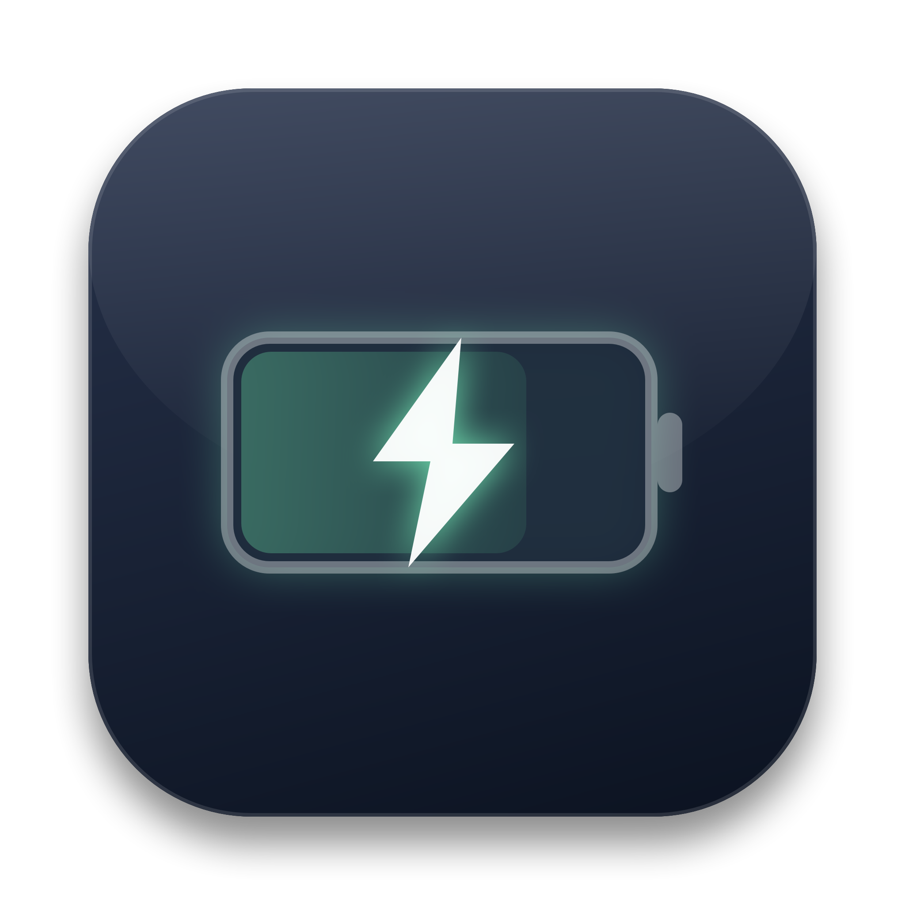

<div align="center">
  
  <h1>ChargeBar</h1>
  <p><strong>Real-time charging wattage and battery telemetry right in your macOS menu bar.</strong></p>

  [](https://modolabs.gumroad.com)
  [-success?style=for-the-badge&logo=apple&logoColor=white)](https://github.com/alaska14/chargebar/releases/latest)
  [](#option-1-homebrew-free)
</div>

<br>

macOS's default battery icon hides the most important information: **How fast is your Mac actually charging?** Is your USB-C monitor or dock trickle-charging at 15W, or fast-charging at 67W, 96W, or 140W?

**ChargeBar** replaces the default battery icon with a featherlight, native AppKit utility that displays your live battery percentage and charging wattage at **0.0% CPU overhead**.

---

## ✨ Features

- ⚡ **Live Charging Wattage:** The moment you connect a charger, ChargeBar reveals the wattage right in the menu bar: `⚡ 98% 67W`.
- 🔋 **Clean On-Battery Display:** Minimalist battery icon and percentage (`98%`) with zero clutter.
- 📊 **Detailed Power Telemetry Menu:**
  - Connected adapter model & rated wattage (e.g. *Apple 70W USB-C Power Adapter*).
  - Net power flow (+45.2W into battery / -10.5W system draw).
  - Battery Health percentage (maximum capacity) and exact cycle count.
  - Estimated time to full charge / time remaining.
- 🎛️ **Full Customization:** Toggle wattage display, percentage, or battery icon independently.
- 🍃 **0.0% CPU Overhead:** Uses native IOKit power source kernel callbacks (`IOPSNotificationCreateRunLoopSource`). Zero polling loops when on battery.

---

## 📦 Installation

### Option 1: Homebrew (Free)
```bash
brew tap alaska14/tap
brew install --cask chargebar
```

### Option 2: Download Free DMG
Download the signed DMG from **[GitHub Releases (v1.0.0)](https://github.com/alaska14/chargebar/releases/latest)**.

### Pro-Tip: Hide the Default macOS Battery Icon
Open **System Settings** → **Control Center** → **Battery** → Set to **"Don't Show in Menu Bar"**. ChargeBar will take over seamlessly!

---

Crafted with care by **Modo Labs** ([modolabs.gumroad.com](https://modolabs.gumroad.com)).
