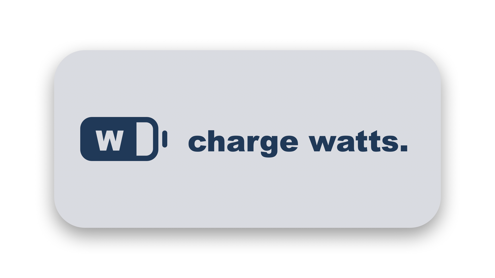

<div align="center">
  
  <br><br>
  <h1>ChargeWatts</h1>
  <p><strong>1:1 pixel-perfect Apple battery replacement that shows live wattage on hover & plug-in.</strong></p>

  [](https://monolabapps.gumroad.com/l/chargewatts)
  [](LICENSE)
  [](https://alternativeto.net/software/chargewatts-by-monolab/)
</div>

<br>

macOS's default battery icon hides the most critical information: **How fast is your Mac actually charging?** Is your desk dock, power bank, or monitor trickle-charging at 15W, or fast-charging at 67W, 96W, or 140W?

**ChargeWatts** is a 1:1 pixel-perfect drop-in replacement for the native macOS battery icon that reveals your charger's wattage with near-zero CPU overhead.

---

## ✨ Features

- 🎯 **1:1 Stock Apple Visual Replication:** Evaluated directly against the native macOS Golden Gate battery cutout (MSE 0.050). Looks completely indistinguishable from the stock battery.
- 🔄 **Automatic Seamless Replacement:** Docks into the exact native battery position (slot 400, between Bluetooth and Wi-Fi) and automatically hides the duplicate Apple stock battery on first launch. Zero configuration or manual toggling required.
- 🚀 **Automatic Autostart:** Automatically adds itself to macOS Login Items upon install so it's always ready when you start your Mac.
- 🔙 **Effortless Uninstallation & Restoration:** If you ever quit or uninstall ChargeWatts (via the 1-click **Uninstall ChargeWatts...** menu option), your original Apple stock battery is immediately restored to its exact original slot.
- 🖱️ **Live Mouse Hover Interaction:** While plugged in, hover over the battery to reveal the charger's negotiated wattage (e.g. `67W`), or the live system draw when fully charged. On battery, the icon stays stock. If no reliable reading is available, ChargeWatts simply shows the percentage instead of guessing.
- ⚡ **Plug-In Pulse:** Momentarily pulses your active charging wattage right inside the battery pill for 2.0s when connecting a charger.
- 🔋 **Intelligent 100% Pass-Through Telemetry:** When fully charged on AC, clearly distinguishes charging from wall pass-through, displaying active live current draw.
- 📊 **De-Cluttered Monochrome Menu:** Minimalist right-click menu showing live wattage/draw, true hardware battery health percentage, cycle count, and time estimates.
- 🍃 **Near-Zero CPU:** Event-driven IOKit callbacks (`IOPSNotificationCreateRunLoopSource`) on battery; a light 4-second refresh only while plugged in.

---

## 📦 Installation

### Get ChargeWatts on Gumroad (recommended)
**[monolabapps.gumroad.com/l/chargewatts](https://monolabapps.gumroad.com/l/chargewatts)** gives you the ready-to-use app as a DMG, plus future updates. Open the DMG and drag `ChargeWatts.app` to `/Applications`.

> **First launch:** MonoLab apps are not notarized by Apple yet. If macOS says the app can't be verified, right-click the app → **Open** (or System Settings → Privacy & Security → **Open Anyway**) once.

### Build from source
ChargeWatts is open source (MIT). If you prefer to build it yourself, you need Apple's Command Line Tools (`xcode-select --install`):
```bash
git clone https://github.com/alaska14/chargewatts.git
cd chargewatts
./build.sh          # creates build/ChargeWatts.app
```

---

## 🛠️ Uninstallation

If you ever wish to remove ChargeWatts, you never have to search through settings to get your old battery back:
- **1-Click Menu Uninstall:** Right-click the ChargeWatts battery icon → Click **"Uninstall ChargeWatts..."**. This automatically restores the native Apple battery, removes ChargeWatts from Login Items, and moves the app to Trash.
- **Manual Restoration (Optional):** If needed, you can toggle the stock battery at any time via **System Settings → Control Center → Battery → Show in Menu Bar**, or by running:
  ```bash
  defaults -currentHost write com.apple.controlcenter Battery -int 2 && killall ControlCenter
  ```

---

Crafted with care by **MonoLab** ([monolabapps.gumroad.com](https://monolabapps.gumroad.com)).
